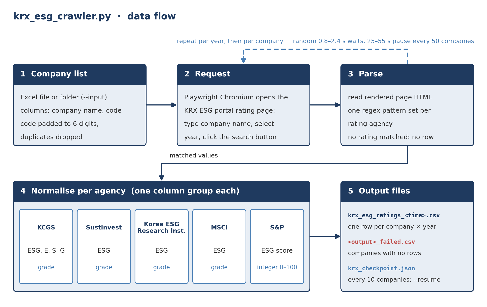

# KRX ESG 등급 크롤러 (krx-esg-ratings-crawler)

A single-script Playwright crawler that reads firm-year ESG ratings shown on the KRX ESG portal (KCGS, Sustinvest, Korea ESG Research Institute, MSCI, S&P) and writes them to a panel-shaped CSV for personal research use.



## 개요

ESG 등급을 변수로 쓰는 실증 분석에는 기업×연도 단위의 패널 데이터가 필요하다. 이 스크립트는 KRX ESG 포털의 등급 조회 화면에서 기업명 입력, 연도 선택, 조회를 기업 목록 전체에 대해 반복하고, 화면에 표시된 평가기관별 등급을 한 행(기업·연도)으로 모아 CSV로 저장한다. 파일 하나(`krx_esg_crawler.py`, 약 600줄)로 구성되며 로컬 PC에서 실행하는 것을 전제로 작성했다.

## 수집 항목

| 출력 열 | 평가기관 | 내용 | 코드가 받아들이는 값 |
|---|---|---|---|
| `KCGS_ESG` | KCGS | ESG 통합등급 | S, A, B, C, D와 `+` 표기 |
| `KCGS_E`, `KCGS_S`, `KCGS_G` | KCGS | 환경·사회·지배구조 영역별 등급 | 위와 같음 |
| `서스틴베스트_ESG` | 서스틴베스트 | ESG 통합등급 | AA, A, BB, B, C, D, E |
| `한국ESG연구소_ESG` | 한국ESG연구소 | ESG 통합등급 | S, A, B, C, D와 `+` 표기 |
| `MSCI_ESG` | MSCI | ESG 통합등급 | AAA, AA, A, BBB, BB, B, CCC |
| `SP_Score` | S&P | ESG 점수 | 0~100 정수 |

식별 열은 `기업명`, `기업코드`(6자리), `연도`다.

## 동작 방식

1. **입력**: `--input`으로 받은 Excel 파일에서 `기업명`, `기업코드` 열을 읽는다. 기업코드는 6자리 문자열로 맞추고 중복 코드는 제거한다. 폴더를 주면 파일명 키워드(평가등급, ESG, KCGS, 등급)와 수정 시각으로 점수를 매겨 Excel 파일 하나를 고른다.
2. **요청**: Playwright Chromium으로 `https://esg.krx.co.kr/contents/02/02010000/ESG02010000.jsp` 한 페이지를 연다. 별도의 API 엔드포인트를 직접 호출하지 않고, 검색창에 기업명을 넣은 뒤 연도를 바꿔 가며 조회 버튼을 누른다. 기본 연도는 2019~2025년이고 `--years`로 바꿀 수 있다.
3. **클릭 재시도**: 조회 버튼은 셀렉터 후보 네 개를 차례로 찾고, 일반 클릭, 강제 클릭, 자바스크립트 클릭 순으로 시도한다. 모두 실패하면 검색창에서 Enter를 누른다. 기업 단위의 재시도는 없으며, 행을 하나도 얻지 못한 기업은 실패 목록에 남긴다.
4. **파싱과 정리**: 렌더링된 페이지 HTML에 평가기관별 정규식을 적용해 위 표의 열에 채운다. KCGS 통합등급은 대문자로 맞추고, S&P 점수는 정수로 바꿔 0~100 범위일 때만 채택한다. 등급이 하나도 잡히지 않은 연도는 행을 만들지 않는다.
5. **요청 간격**: 조회 클릭 뒤 1.2~2.0초, 연도 사이 0.8~1.5초, 기업 사이 1.2~2.4초를 무작위로 쉬고, 기업 50개마다 25~55초를 추가로 쉰다. Playwright `slow_mo` 기본값은 150ms다.
6. **체크포인트**: 기업 10개마다 진행 위치와 누적 결과를 `krx_checkpoint.json`에 저장하고, `--resume`으로 그 지점부터 이어서 실행한다.
7. **차단 확인**: 첫 접속 응답에 `Access Denied` 또는 `일시 제한` 문구가 있으면 수집을 시작하지 않고 끝낸다.

## 설치와 실행

Python 3.10 이상이 필요하다.

```bash
pip install playwright pandas openpyxl tqdm
playwright install chromium
```

```bash
# 기업 10개만, 브라우저 창을 띄운 채로 동작 확인
python krx_esg_crawler.py --input companies.xlsx --max 10 --output krx_esg_result.csv

# 시트를 지정하고 헤드리스로 전체 실행
python krx_esg_crawler.py --input companies.xlsx --sheet "평가등급" --headless --output krx_esg_result.csv

# 중단된 지점부터 재개
python krx_esg_crawler.py --input companies.xlsx --headless --resume --output krx_esg_result.csv
```

| 옵션 | 설명 |
|---|---|
| `--input`, `-i` | 기업 목록 Excel 파일 또는 폴더 (필수) |
| `--sheet` | 기업 목록 시트명. 생략하면 첫 시트 |
| `--output`, `-o` | 출력 CSV 파일명 |
| `--max`, `-m` | 처리할 최대 기업 수 |
| `--years` | 수집 연도. 예: `"2021,2022,2023"` |
| `--headless` | 브라우저 창 없이 실행. 생략하면 창이 뜬다 |
| `--resume` | 체크포인트에서 재개 |
| `--slow-mo` | Playwright 동작 지연(ms). 기본 150 |
| `--debug` | 실패 시점의 HTML·스크린샷과 실행 중 JSON 응답 로그를 `debug_dump/`에 저장 |

## 출력 형식

- **등급 CSV**: 기업·연도당 한 행, 인코딩은 `utf-8-sig`(Excel에서 바로 열림). `--output`을 생략하면 `krx_esg_ratings_YYYYMMDD_HHMMSS.csv`로 저장한다. 정상 종료 시에만 기록되므로, 중간에 중단한 경우 결과는 체크포인트 파일에만 남는다.
- **실패 목록**: `<출력 파일명>_failed.csv`. 열은 `기업명`, `기업코드`, `사유`.
- **체크포인트**: `krx_checkpoint.json`. `processed_idx`, `data`, `failed`, `timestamp`를 담는다.
- **디버그 산출물**(`--debug`): `debug_dump/` 아래 `page_*.html`, `page_*.png`, `button_outerhtml_*.txt`, `network_jsonl_*.jsonl`.

```text
기업명,기업코드,연도,KCGS_ESG,KCGS_E,KCGS_S,KCGS_G,서스틴베스트_ESG,한국ESG연구소_ESG,MSCI_ESG,SP_Score
```

## 주의사항과 한계

- 셀렉터와 정규식은 특정 시점의 페이지 구조를 가정한다. 구조가 바뀌면 값이 비거나 틀릴 수 있고, 이 저장소에는 수집 결과나 정확도 검증 자료를 싣지 않았다.
- 정규식은 평가기관 이름 뒤 같은 텍스트 구간에서 처음 나오는 등급 문자를 잡는다. 라벨 문구의 글자(예: `ESG`의 S, E)가 등급으로 잡힐 수 있으므로 분석에 쓰기 전에 원 화면과 표본 대조가 필요하다.
- `KCGS_E`, `KCGS_S`, `KCGS_G`는 페이지 전체에서 영역명(`환경`, `사회`, `지배구조`) 뒤의 첫 등급 문자를 잡는다. 같은 단어가 다른 문맥에 나오면 그 값이 들어갈 수 있어 표본 대조가 필요하다.
- `SP_Score`는 HTML에서 `S&P`가 `S&amp;P`로 직렬화되면 정규식에 잡히지 않을 수 있다.
- 연도 선택이 실패해도 조회를 계속하고, 추출 단계에서 화면의 연도를 다시 확인하지 않는다. 행의 `연도` 값이 실제 화면과 어긋날 수 있다.
- 조회는 기업명으로만 하며 기업코드는 결과에 붙이는 식별자로만 쓴다. 이름이 겹치는 기업은 구분하지 못한다.
- 코드에 적힌 대기 시간만 더해도 기본 7개 연도 기준 기업당 약 17~31초가 걸린다(네트워크와 렌더링 시간 제외). 차단 여부는 첫 접속 때만 확인한다.
- `run_krx_crawler.bat`는 현재 CLI와 맞지 않는다. 1번 메뉴는 필수 인자 `--input` 없이 실행해 오류로 끝나고, 2~4번 메뉴는 괄호 블록 안에서 변수가 먼저 치환되어 입력한 파일명 대신 빈 경로가 넘어가고, 그 결과 현재 폴더의 Excel 파일이 자동 선택된다. 위의 명령을 직접 실행하는 편이 낫다.

## 데이터 출처와 이용 유의

- 출처는 [KRX ESG 포털](https://esg.krx.co.kr)이며, 등급과 점수에 대한 권리는 한국거래소(KRX)와 각 평가기관에 있다.
- 개인 연구용으로 작성한 스크립트다. KRX나 평가기관의 승인을 받았거나 제휴한 도구가 아니며, 자동 수집이 허용되는지는 이용자가 직접 확인해야 한다.
- 사이트 이용약관과 robots 정책을 따르고, 요청 간격을 코드 기본값보다 줄이지 않는다. 차단 응답을 받으면 수집을 멈춘다.
- 코드에는 고정 User-Agent 지정과 `navigator.webdriver` 값 재정의 같은 브라우저 설정이 들어 있다. 사이트 정책이 자동 접근을 금지한다면 사용하지 않는다.
- 수집한 등급 데이터는 재배포하지 않는다. 이 저장소에도 수집 데이터는 포함하지 않았다.

---

김재하 (Jaeha Kim) · [github.com/summerjinhere](https://github.com/summerjinhere)
